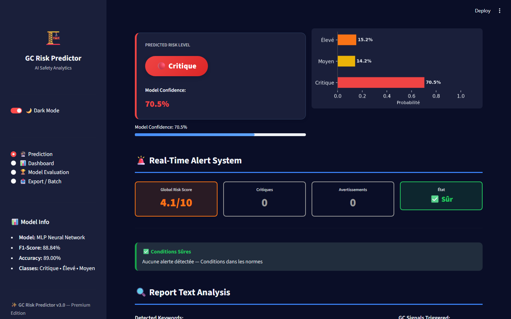
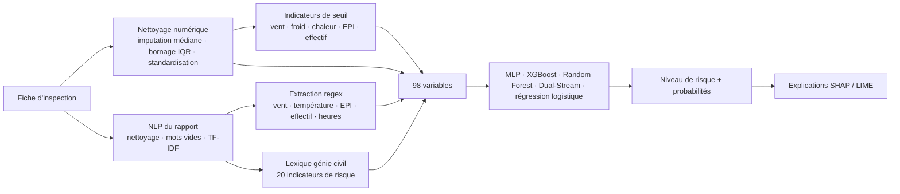
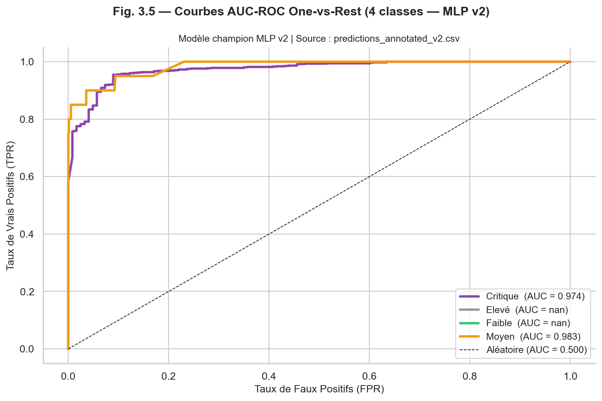
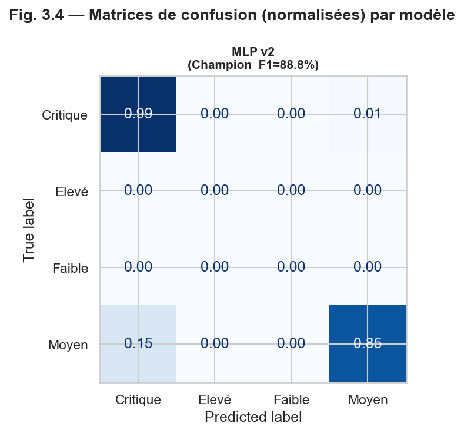
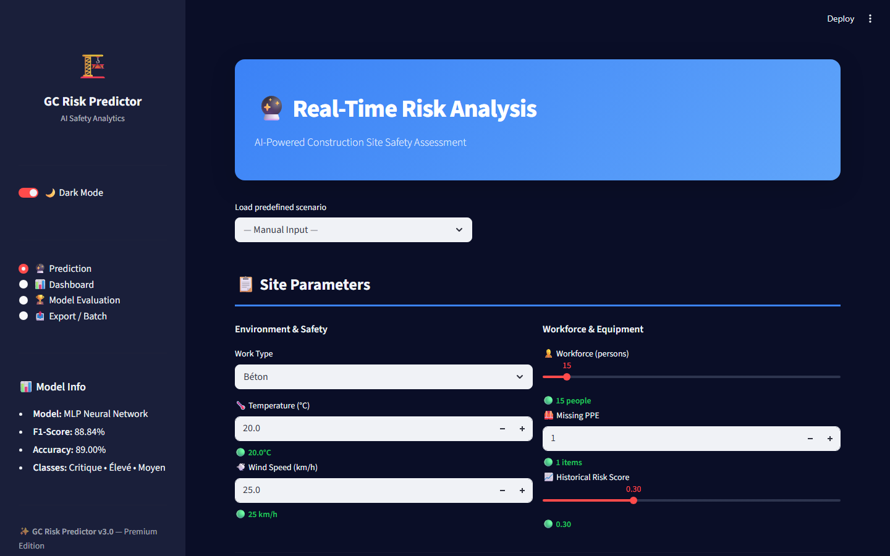
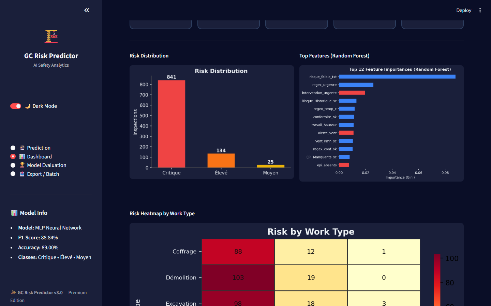

# 🏗️ GC Safety AI — Prédiction du risque sur chantier

> Prédit le niveau de risque d'un chantier (**Critique / Élevé / Moyen**) à partir des mesures du site **et** du texte libre du rapport d'inspection, explique chaque prédiction (SHAP / LIME) et déclenche des alertes réglementaires en temps réel, dans un tableau de bord Streamlit interactif.

🇬🇧 [English version](README.md)




---

## 📌 Contexte

Sur un chantier, le responsable sécurité remplit une fiche d'inspection : type de travaux, effectif, météo, équipements de protection individuelle (EPI) manquants et un rapport écrit. Le risque d'accident dépend de tout cela à la fois : un vent de 50 km/h est acceptable pour de la maçonnerie, pas pour du grutage ; un rapport qui dit *« harnais absent, intervention corrective urgente »* compte autant que les chiffres.

**GC Safety AI** (*Génie Civil*) transforme ces fiches en un niveau de risque exploitable :
- il combine les **données structurées** et l'analyse en **langage naturel** du rapport ;
- il **explique** pourquoi un chantier est jugé critique ;
- il vérifie les valeurs saisies par rapport aux **seuils de sécurité du génie civil** et alerte pendant la saisie.

Le cahier des charges se trouve dans [`docs/Cahier des charges.pdf`](docs/Cahier%20des%20charges.pdf).

## 🗂️ Jeu de données

[`Dataset.csv`](Dataset.csv) : **1 000 inspections**, volontairement proches du terrain, avec environ **35 % de valeurs manquantes** dans chaque colonne numérique et dans le type de travaux.

| Colonne | Description |
|---|---|
| `Type_Travaux` | démolition, excavation, travail en hauteur, coffrage, grutage, soudure |
| `Effectif` | nombre de travailleurs sur le chantier |
| `Temperature`, `Vent_kmh` | météo (°C, vent en km/h) |
| `EPI_Manquants` | nombre d'EPI manquants |
| `Risque_Historique` | risque historique du chantier (0–1) |
| `Rapport_inspection` | rapport en français (environ 440 caractères en moyenne) |
| étiquette | `Critique` (877) · `Élevé` (103) · `Moyen` (20) |

## ⚙️ Pipeline



1. **Prétraitement numérique** : imputation par la médiane, valeurs extrêmes bornées par la règle IQR × 1,5, standardisation.
2. **Prétraitement du texte** : minuscules, suppression de la ponctuation et des mots vides français, **TF-IDF** (alternative légère à CamemBERT, sans GPU).
3. **Feature engineering** : valeurs extraites du rapport par **regex** (vitesse du vent, température, nombre d'EPI, effectif, heures, urgence, arrêt de chantier, conformité), **20 indicateurs lexicaux** (harnais / casque / gilet manquant, vent fort, gel, canicule, pluie, chute d'objets, risque électrique ou chimique, travail en hauteur, excavation…), indicateurs de dépassement de seuil et encodage du type de travaux.
4. **Modélisation** : découpage stratifié 80 / 20, **SMOTE** uniquement sur l'entraînement, validation croisée stratifiée à 5 plis, optimisation des hyperparamètres de XGBoost.
5. **Évaluation** : matrices de confusion, courbes ROC, F1 par modèle, analyse des erreurs critiques (chantiers jugés moins dangereux qu'ils ne le sont) et **robustesse** au bruit gaussien (σ de 0,05 à 0,30 de l'écart-type de chaque variable).
6. **Explicabilité** : SHAP et LIME, avec une lecture « génie civil » des variables les plus importantes.

## 🚨 Seuils de sécurité

| Mesure | Alerte | Danger / critique |
|---|---|---|
| Vent | > 45 km/h | > 80 km/h |
| Température | < 5 °C (froid) · > 35 °C (chaleur) | — |
| EPI manquants | — | ≥ 5 |
| Effectif | > 30 travailleurs (surveillance) | — |

Le formulaire n'accepte que des valeurs physiquement possibles (vent de 0 à 250 km/h, température de −30 à 60 °C…).

## 📊 Résultats (jeu de test)

| Modèle | Accuracy | F1 (pondéré) |
|---|---|---|
| **Réseau de neurones MLP** (déployé) | **0,890** | **0,888** |
| XGBoost (optimisé) | 0,885 | 0,885 |
| Dual Stream | 0,890 | 0,884 |
| Random Forest | 0,865 | 0,863 |
| Régression logistique | 0,850 | 0,865 |

| Courbes ROC | Matrices de confusion |
|---|---|
|  |  |

**Vue par classe et étude de rééquilibrage.** Le MLP déployé détecte **99 %** des chantiers critiques, mais seulement environ un quart des cas *Élevé* et *Moyen*, car ces classes sont rares. [`scripts/retrain_balanced.py`](scripts/retrain_balanced.py) compare, sur le même découpage, le sur-échantillonnage, la régression logistique et la forêt aléatoire pondérées, et l'ajustement du seuil. Une régression logistique pondérée obtient un meilleur macro-F1 (0,67 contre 0,55) mais rate 14 % des chantiers critiques, l'erreur la plus coûteuse sur un chantier : le modèle à fort rappel est donc conservé.

## 🖥️ Tableau de bord

| Page | Contenu |
|---|---|
| **Prédiction** | formulaire du chantier + rapport d'inspection, 4 scénarios prédéfinis (par exemple *grutage par vent fort*), alertes réglementaires en direct, niveau prédit avec probabilités, score de risque global, mots-clés et signaux génie civil détectés |
| **Tableau de bord** | distribution du risque, importance des variables, carte de chaleur par type de travaux |
| **Évaluation des modèles** | métriques des 5 modèles, matrice de confusion |
| **Export / Lot** | télécharger l'historique annoté ou un modèle CSV, importer un CSV d'inspections, tout prédire et télécharger les résultats |

Thèmes clair et sombre. Un avertissement s'affiche quand le rapport est vide, car le modèle s'appuie beaucoup sur le texte.

| Formulaire de prédiction | Analyses |
|---|---|
|  |  |

## 🚀 Installation

```bash
git clone https://github.com/MohamedTrikii/gc-safety-ai.git
cd gc-safety-ai
python -m venv .venv && .venv\Scripts\activate      # Linux/macOS : source .venv/bin/activate
pip install -r requirements.txt
streamlit run app_dashboard.py
```

Les modèles entraînés sont fournis dans [`models/`](models/) : l'application se lance immédiatement.
Pour réentraîner, exécutez les notebooks dans l'ordre : `preprocessing_chantier.ipynb` → `chantier_risque_prediction.ipynb`.

## 📁 Structure

```
├── app_dashboard.py                 # application Streamlit (point d'entrée)
├── core/                            # seuils, lexique, regex, construction des variables, prédiction
├── components/ · pages/             # composants d'interface, graphiques et modules de pages
├── preprocessing_chantier.ipynb     # nettoyage, NLP, feature engineering
├── chantier_risque_prediction.ipynb # entraînement, évaluation, robustesse, SHAP/LIME, export
├── projet.ipynb                     # expériences d'ensemble learning (stacking, bagging, voting)
├── models/                          # modèles entraînés (joblib)
├── Dataset.csv                      # 1 000 inspections
├── docs/                            # cahier des charges, figures, captures, présentation
└── scripts/                         # generate_presentation.py (présentation) · retrain_balanced.py (étude de rééquilibrage)
```

## ⚠️ Limites

- 1 000 inspections seulement, avec très peu de cas *Moyen* : résultats à confirmer sur des données réelles de chantier.
- Le modèle s'appuie beaucoup sur le texte du rapport ; un rapport vide donne une prédiction moins fiable.

## 👤 Auteur

**Mohamed Triki** — [GitHub](https://github.com/MohamedTrikii)
