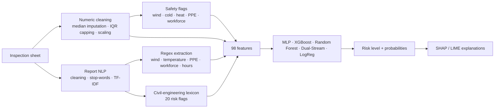

# 🏗️ GC Safety AI — Construction-Site Risk Prediction

> Predicts the safety-risk level of a construction site (**Critique / Élevé / Moyen**) from the site measurements **and** the free-text inspection report, explains each prediction (SHAP / LIME), and raises regulatory alerts in real time — in an interactive Streamlit dashboard.

🇫🇷 [Version française](README.fr.md)


---

## 📌 Context

On a construction site, the safety officer fills an inspection sheet: work type, workforce, weather, missing personal protective equipment (PPE) and a written report. The risk of an accident depends on all of it — a wind of 50 km/h is acceptable for masonry, not for crane lifting; a report saying *"harness missing, urgent corrective action"* matters as much as the numbers.

**GC Safety AI** (*Génie Civil*) turns these sheets into a risk level the officer can act on:
- it combines **structured data** and **natural-language** analysis of the report;
- it **explains** why a site is rated critical;
- it checks the inputs against **civil-engineering safety thresholds** and raises alerts as they are typed.

The specification is in [`docs/Cahier des charges.pdf`](docs/Cahier%20des%20charges.pdf).

## 🗂️ Dataset

[`Dataset.csv`](Dataset.csv) — **1,000 inspections**, deliberately "field-like": about **35 % missing values** in every numeric column and in the work type.

| Column | Description |
|---|---|
| `Type_Travaux` | demolition, excavation, work at height, formwork, crane lifting, welding |
| `Effectif` | number of workers on site |
| `Temperature`, `Vent_kmh` | weather (°C, wind km/h) |
| `EPI_Manquants` | number of missing PPE items |
| `Risque_Historique` | historical risk of the site (0–1) |
| `Rapport_inspection` | free-text report in French (≈ 440 characters on average) |
| label | `Critique` (877) · `Élevé` (103) · `Moyen` (20) |

## ⚙️ Pipeline



1. **Numeric preprocessing** — median imputation, outliers capped with the IQR × 1.5 rule, standardisation.
2. **Text preprocessing** — lower-casing, punctuation and French stop-words removal, **TF-IDF** (a light alternative to CamemBERT that runs without GPU).
3. **Feature engineering** — values re-extracted from the report with **regex** (wind speed, temperature, PPE count, workforce, hours, urgency, site stop, compliance), **20 lexicon flags** (missing harness / helmet / vest, strong wind, frost, heat wave, rain, falling objects, electrical or chemical risk, work at height, excavation…), safety-threshold flags and work-type one-hot encoding.
4. **Modelling** — stratified 80 / 20 split, **SMOTE** on the training set only, stratified 5-fold cross-validation, hyper-parameter tuning of XGBoost.
5. **Evaluation** — confusion matrices, ROC curves, F1 by model, analysis of critical errors (sites predicted safer than they are) and **robustness** to Gaussian noise (σ from 0.05 to 0.30 of each feature's standard deviation).
6. **Explainability** — SHAP and LIME, with a civil-engineering reading of the most important features.

## 🚨 Safety thresholds

| Measure | Alert | Danger / critical |
|---|---|---|
| Wind | > 45 km/h | > 80 km/h |
| Temperature | < 5 °C (cold) · > 35 °C (heat) | — |
| Missing PPE | — | ≥ 5 items |
| Workforce | > 30 workers (supervision) | — |

The form only accepts physically possible values (wind 0–250 km/h, temperature −30 / 60 °C…).

## 📊 Results (test set)

| Model | Accuracy | F1 (weighted) |
|---|---|---|
| **MLP Neural Network** (deployed) | **0.890** | **0.888** |
| XGBoost (tuned) | 0.885 | 0.885 |
| Dual Stream | 0.890 | 0.884 |
| Random Forest | 0.865 | 0.863 |
| Logistic Regression | 0.850 | 0.865 |

| ROC curves | Confusion matrices |
|---|---|
|  |  |

**Per-class view and balancing study.** The deployed MLP catches **99 %** of critical sites, but only about a quarter of *Élevé* and *Moyen* ones, because these classes are rare. [`scripts/retrain_balanced.py`](scripts/retrain_balanced.py) compares, on the same split, oversampling, class-weighted logistic regression and random forest, and threshold tuning. A weighted logistic regression reaches a better macro-F1 (0.67 vs 0.55) but misses 14 % of critical sites — the costliest error on a construction site — so the high-recall model is kept.

## 🖥️ Dashboard

| Page | What it shows |
|---|---|
| **Prediction** | site form + inspection report, 4 predefined scenarios (e.g. *crane lifting in strong wind*), live regulatory alerts, predicted level with probabilities, global risk score, detected keywords and civil-engineering signals |
| **Dashboard** | risk distribution, feature importance, risk heat-map by work type |
| **Model evaluation** | metrics of the 5 models, confusion matrix |
| **Export / Batch** | download the annotated history or a CSV template, upload a CSV of inspections, predict them all and download the results |

Light / dark themes. A warning is shown when the report is empty, because the model relies heavily on the text.

| Prediction form | Analytics |
|---|---|
|  |  |

## 🚀 Getting started

```bash
git clone https://github.com/MohamedTrikii/gc-safety-ai.git
cd gc-safety-ai
python -m venv .venv && .venv\Scripts\activate      # Linux/macOS: source .venv/bin/activate
pip install -r requirements.txt
streamlit run app_dashboard.py
```

The trained models are included in [`models/`](models/), so the app runs immediately.
To retrain, run the notebooks in order: `preprocessing_chantier.ipynb` → `chantier_risque_prediction.ipynb`.

## 📁 Project structure

```
├── app_dashboard.py                 # Streamlit app (entry point)
├── core/                            # thresholds, lexicon, regex, feature building, prediction logic
├── components/ · pages/             # UI components, charts and page modules
├── preprocessing_chantier.ipynb     # cleaning, NLP, feature engineering
├── chantier_risque_prediction.ipynb # training, evaluation, robustness, SHAP/LIME, export
├── projet.ipynb                     # ensemble-learning experiments (stacking, bagging, voting)
├── models/                          # trained models (joblib)
├── Dataset.csv                      # 1,000 inspections
├── docs/                            # specification, figures, screenshots, slides
└── scripts/                         # generate_presentation.py (slides) · retrain_balanced.py (class-balancing study)
```

## ⚠️ Limitations

- 1,000 inspections only, with very few *Moyen* cases: results should be confirmed on real site data.
- The model relies heavily on the report text; an empty report gives a less reliable prediction.

## 👤 Author

**Mohamed Triki** — [GitHub](https://github.com/MohamedTrikii)
